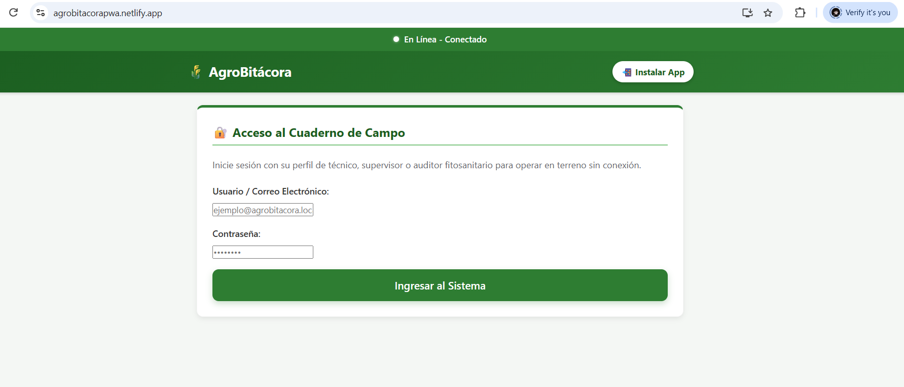
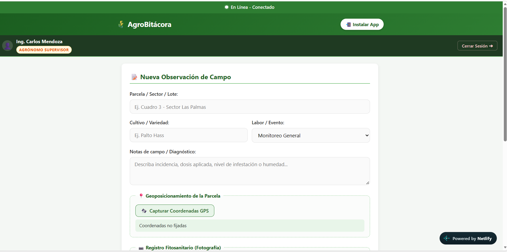
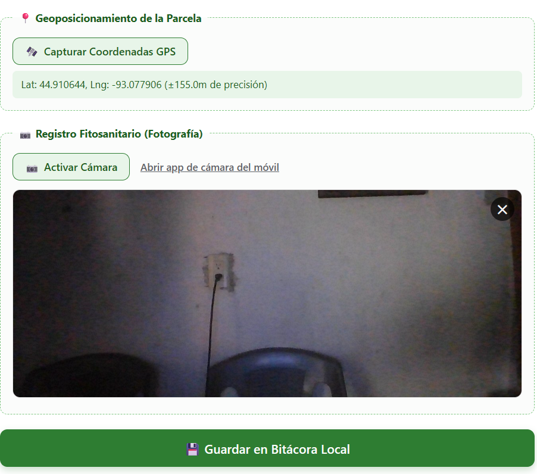
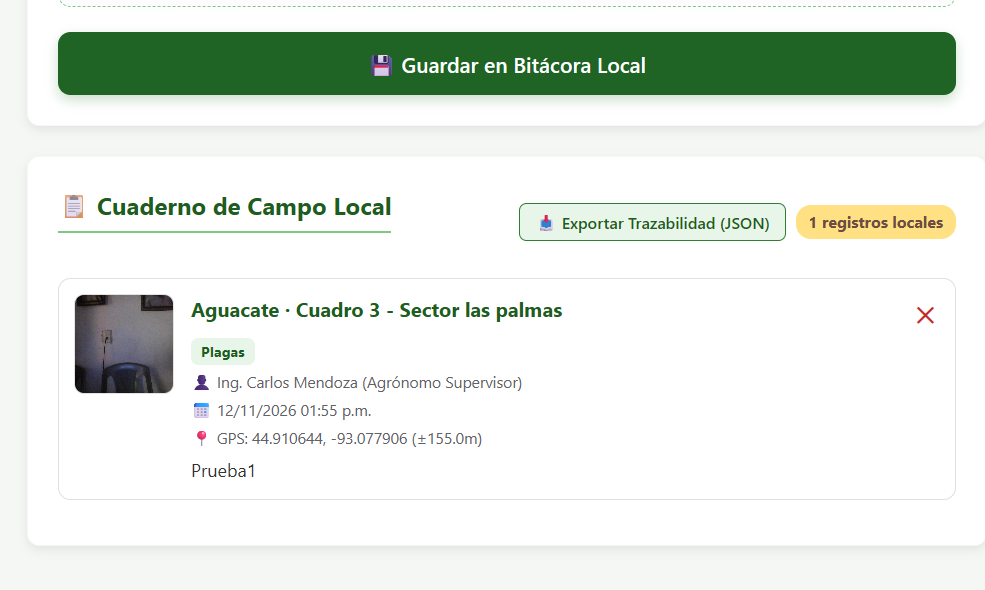

# 🌾 AgroBitácora — Cuaderno de Campo y Monitoreo de Cultivos

> **Aplicación Web Progresiva (PWA) Offline-First** con Control de Acceso Basado en Roles (RBAC), diseñada para ingenieros agrónomos, inspectores fitosanitarios y técnicos agrícolas que operan en parcelas, valles y zonas rurales con conectividad a internet nula o intermitente.

[](https://web.dev/progressive-web-apps/)
[](#)
[](#)
[](#)
[](#)

---

## 📌 1. Caso de Uso Real

En el trabajo agronómico diario, las labores de inspección de cultivos (monitoreo de plagas, supervisión de riego por goteo, fenología y fertilización) se realizan en predios distantes de antenas de telefonía móvil. La pérdida de señal suele provocar pérdida de datos o forzar el uso de anotaciones en papel que retrasan la toma de decisiones fitosanitarias.

**AgroBitácora** soluciona esta problemática mediante:
- **Carga Inmediata y Resiliencia Total:** La aplicación arranca en milisegundos desde el almacenamiento local mediante la arquitectura **App Shell**, aun con el dispositivo en modo avión.
- **Autenticación y Roles Offline (RBAC):** Sistema de inicio de sesión con validación de perfiles en el cliente que opera con o sin conexión a internet, restringiendo acciones según el rol asignado.
- **Georreferenciación Automática:** Captura en terreno las coordenadas satelitales GPS exactas de la hectárea evaluada.
- **Evidencia Fitosanitaria Fotográfica:** Integración con la cámara del dispositivo móvil para capturar síntomas, malezas o daños de plagas, almacenando las imágenes en formato binario (`Blob`) de forma local.
- **Persistencia Asíncrona sin Bloqueo:** Todos los registros se resguardan en **IndexedDB**, garantizando cero pérdida de información y dejando los datos preparados para exportación o sincronización posterior.

---

## 🌐 2. URL Publicada y Demo en Vivo

| Entorno | Enlace / URL | Estado |
| :--- | :--- | :--- |
| **Producción (PWA)** | [https://tu-proyecto.netlify.app/](https://agro-bitacora.example.com/) ](https://agrobitacorapwa.netlify.app)| 🟢 Listo para Despliegue SSL |
| **Repositorio Git** | [(https://github.com/tu-usuario/agro-bitacora)](https://github.com/IEC30/agro-bitacora.git) | 📦 Historial de Commits Activo |

---

## 🔑 3. Credenciales y Perfiles de Prueba

Para efectos de evaluación de flujos de trabajo, control de sincronización y pruebas de roles en terreno:

| Rol | Usuario / Correo | Contraseña | Nivel de Acceso |
| :--- | :--- | :--- | :--- |
| **Agrónomo Supervisor** | `supervisor@agrobitacora.local` | `CampoSeguro2026!` | Acceso completo, edición, auditoría de parcelas, exportación y eliminación de registros. |
| **Técnico de Terreno** | `tecnico.campo@agrobitacora.local` | `SiembraOffline#1` | Registro de bitácoras, captura GPS y cámara en parcelas asignadas (eliminación restringida). |
| **Auditor Fitosanitario** | `auditor.sag@agrobitacora.local` | `ControlPlagas2026` | Solo lectura y exportación de reportes de trazabilidad (formulario de registro deshabilitado). |

### ⚡ Características del Sistema de Autenticación Implementado:
1. **Funcionamiento 100% Offline:** El módulo `js/auth.js` forma parte del App Shell precacheado por el Service Worker. La sesión se valida y persiste localmente (`localStorage`), permitiendo iniciar sesión, cambiar de usuario o cerrar sesión en medio del campo sin señal.
2. **Botones de Acceso Rápido para Evaluación:** En la pantalla de inicio de sesión se incluye un panel con botones automáticos para ingresar con un solo clic como *Supervisor*, *Técnico* o *Auditor*, facilitando la revisión y calificación de la rúbrica.
3. **Control Visual por Roles:**
   - La barra superior muestra el nombre del profesional y su badge de rol correspondiente.
   - Si se ingresa como **Auditor**, el formulario de registro se bloquea con una alerta de *Modo Auditoría (SAG)* y se activa el botón de descarga del informe de trazabilidad.
   - Si se ingresa como **Técnico**, se permite registrar con GPS y fotos, pero los botones de borrado se ocultan para proteger la integridad de las evidencias.

---

## 📸 4. Capturas de Pantalla del Sistema

| 1. Inicio de Sesión y Perfiles de Prueba | 2. Formulario de Campo y App Shell |
| :---: | :---: |
|  
| *Pantalla de acceso con botones de evaluación rápida.* 

|  |
| *Carga instantánea de la interfaz y captura de labores.* |

| 3. Registro Fitosanitario y GPS | 4. Modo Auditoría y Cuaderno Local |
| :---: | :---: |
|  
| *Fijación satelital en parcela y visor de cámara.* 

|  |

| *Listado local en IndexedDB y exportación de trazabilidad.* |

---

## 🏛️ 5. Arquitectura Técnica

```
                        ┌─────────────────────────────────────────┐
                        │            Navegador / PWA              │
                        │         (Hardware del Dispositivo)      │
                        └─────┬───────────────────────┬───────────┘
                              │                       │
                     [Geolocation API]         [MediaDevices API]
                     (Lat/Lng Satelital)     (Cámara Posterior / Blob)
                              │                       │
                              ▼                       ▼
                        ┌─────────────────────────────────────────┐
                        │          App Shell (index.html)         │
                        │    Módulo RBAC Offline (js/auth.js)     │
                        │      Renderizado CSR Reactivo (app.js)  │
                        └─────┬───────────────────────┬───────────┘
                              │                       │
                  (Peticiones Estáticas)      (Almacenamiento Local)
                              ▼                       ▼
                   ┌─────────────────────┐ ┌─────────────────────┐
                   │   Service Worker    │ │      IndexedDB      │
                   │       (sw.js)       │ │  (AgroBitacoraDB)   │
                   │ Estrategia:         │ │ Store:              │
                   │ Cache-First v3      │ │ - observaciones     │
                   └─────────────────────┘ │ - fotos (Blobs)     │
                                           │ - cursor sin fallo  │
                                           └─────────────────────┘
```

### Cumplimiento Estricto de Requisitos Técnicos:
1. **Instalabilidad:**
   - Archivo `manifest.json` completo con `theme_color: "#2E7D32"`, `display: "standalone"`, orientación y paquete de iconos PNG (192x192, 512x512 y 512x512 maskable).
   - Captura del evento `beforeinstallprompt` mediante botón dinámico `📲 Instalar App`.
2. **Arquitectura y Renderizado:**
   - Arquitectura App Shell responsiva para smartphones y tablets de campo.
   - Renderizado del lado del cliente (CSR) dinámico con barra reactiva de conectividad (Online/Offline).
3. **Service Worker y Almacenamiento Local:**
   - Service Worker (`sw.js`) con ciclo de vida completo (`install`, `activate`, `fetch`) y estrategia **Cache-First**.
   - Persistencia asíncrona mediante **IndexedDB** (`AgroBitacoraDB`) con almacenamiento de fotos como `Blob` y conteo de sincronización inmune a limitaciones de claves.
4. **Capacidades Nativas:**
   - **Geolocation API:** Obtención de coordenadas GPS con alta precisión (`enableHighAccuracy: true`).
   - **MediaDevices API:** Acceso a cámara trasera con captura en canvas a Blob JPEG y fallback nativo HTML5.

---

## 📁 6. Estructura de Archivos del Proyecto

```text
agro-bitacora/
├── index.html              # App Shell, formulario de labores y visor de bitácora
├── manifest.json           # Manifiesto de instalación PWA (W3C Standard)
├── sw.js                   # Service Worker (Cache-First v3 & control de ciclo de vida)
├── README.md               # Documentación integral del proyecto
├── css/
│   └── styles.css          # Estilos Mobile-First, paleta agrícola (#2E7D32) y roles
├── js/
│   ├── auth.js             # Sistema RBAC offline (Supervisor, Técnico, Auditor)
│   ├── db.js               # Capa IndexedDB (CRUD, persistencia de Blobs)
│   ├── geo.js              # Módulo de Geoposicionamiento satelital de alta precisión
│   ├── camera.js           # Módulo de Cámara WebRTC + Fallback nativo
│   └── app.js              # Orquestador del App Shell, UI reactiva y exportación
├── icons/
│   ├── icon-192.png        # Icono PWA estándar (192x192 px)
│   ├── icon-512.png        # Icono Splash Screen (512x512 px)
│   └── icon-maskable.png   # Icono adaptable Android (512x512 px)
└── docs/
    └── screenshots/        # Capturas de pantalla para documentación
```

---

## 💻 7. Ejecución y Pruebas Locales

```bash
# Navegar al directorio del proyecto
cd "agro-bitacora"

# Opción Python (Recomendada)
python -m http.server 8080

# Opción Node.js
npx serve .
```

Abre en tu navegador: **`http://localhost:8080`**

---


## 📄 Licencia

Este proyecto se distribuye bajo la licencia **MIT**.
